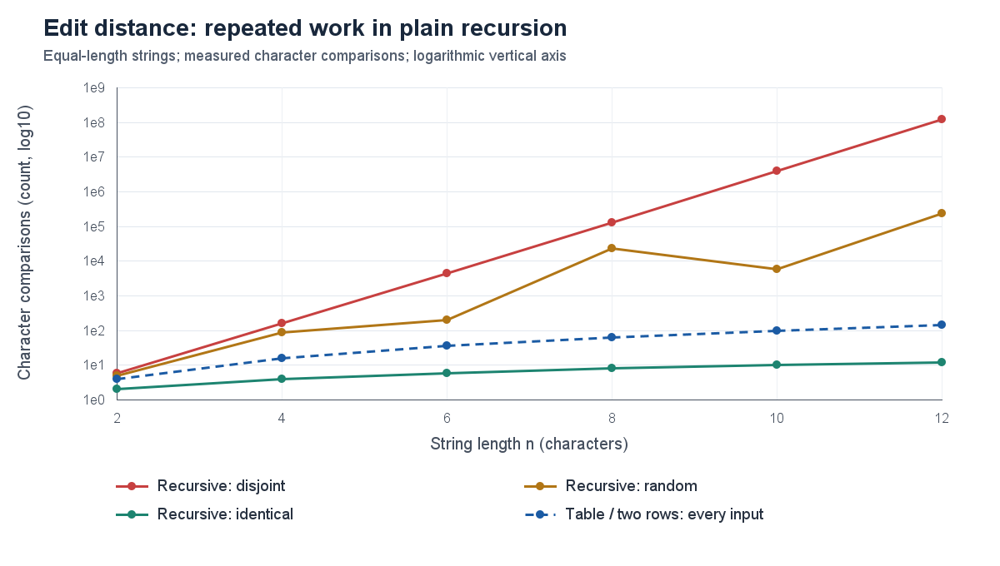
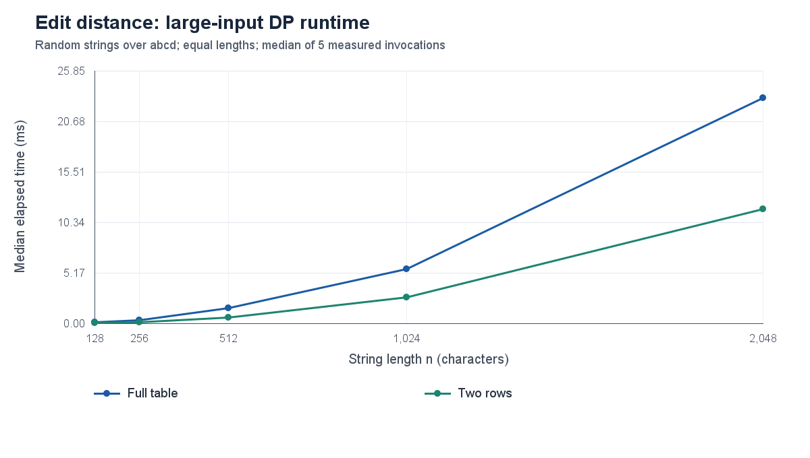
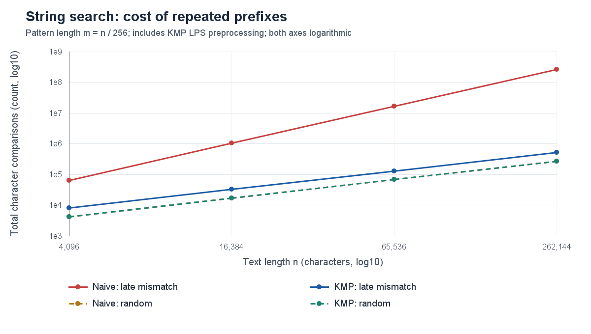
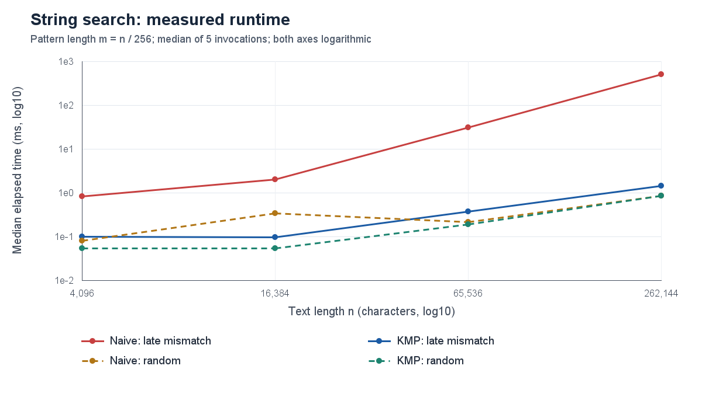

# Assignment 4 - Dynamic Programming and String Algorithms

**Iskander Shaimerdinov | SE-2524**  
Repository: https://github.com/IShaymerden/DAA_Assignment4  
Branch: `main` | Tag: `v1.0`

## 1. Experiment Design Card (written before measurements)

| Field | Plan |

|---|---|

| Questions | Edit: how does repeated recursion compare with DP work and storage? Search: how much does KMP prefix reuse reduce repeated-prefix work? |

| Sizes and rationale | All edit versions: n = 2, 4, 6, 8, 10, 12 (6x range). Table/two rows also use 128, 256, 512, 1024, 2048 (16x). Both searches: n = 4096, 16384, 65536, 262144 (64x), m = n/256. Small recursion is affordable; larger DP/search cases give useful elapsed times. |

| Input purpose | Edit: identical strings expose the equality shortcut; independent random abcd strings show mixed matches; a^n vs b^n forces all recursive branches. Search: random lowercase text with a copied middle pattern guarantees a match; b^n vs a^m rejects early; a^n vs a^(m-1)b forces late mismatches. |

| Metrics | Median time of 5 runs in ms. Edit: calls, interior DP updates, character comparisons, allocated int slots. Search: text/pattern comparisons plus separately recorded LPS comparisons. Counters increment inside the algorithms. Storage slots exclude object headers and stack frames. |

| Reproducibility | Own generator using Java Random, seed 25242026 mixed with n and input type. Generate outside timing; record SHA-256 fingerprints. A 2000-iteration small-input warm-up and one invocation per case precede measurement; rotate algorithm order. Same inputs, results and counters repeat, not identical wall-clock times. |

| Prediction | Disjoint recursion grows exponentially, identical recursion linearly. DP updates n*m cells; full-table storage is quadratic, two rows linear. With m=n/256, late-mismatch Naive is quadratic; KMP is linear. Easy/random Naive may compete with KMP. |

| Planned plots | 1: small edit comparisons (log y). 2: large random DP median time. 3: search comparisons (log-log). 4: search median time (log-log). These separate operation growth, practical time and input sensitivity. |

The card was saved in EXPERIMENT_DESIGN.md and committed before the benchmark; no design changes were made after measurements. The experiment contains 108 cases x 5 runs = 540 raw rows. Timing includes counter reset, allocation, LPS construction and result construction; it excludes generation, verification, CSV output and charts. Results are checked outside the timed region. Windows 11 amd64, Java HotSpot 25.0.1, 12 logical processors; measured on 8 November 2026. Raw runs, medians/ranges and environment details accompany the report.

## 2. Edit distance - prediction vs result

Prediction vs result: disjoint recursion shows the expected explosive growth, while both DP versions perform exactly n*m comparisons and cell updates. At n=12, disjoint recursion makes 377,393,953 calls and 125,797,984 character comparisons; DP makes only 144 comparisons. The random curve falls from n=8 to n=10 because different generated strings trigger different equality shortcuts; it is one sample per size, not an average over many strings.

Takeaway: the log scale reveals exponential repeated work on disjoint strings, whereas identical recursion follows only one diagonal path.

Takeaway: both DP runtimes rise with size; on random n=2048, two rows takes 11.754 ms versus 23.084 ms for the full table.

At n=2048 both versions update 4,194,304 cells. Their allocated integer slots are 4,198,401 (table) and 4,098 (two rows), a 1024.5x reduction; this measures storage structure, not total heap usage. The observed time advantage is specific to this run and is consistent with less allocation and a smaller working set.

## 3. String search - prediction vs result

Prediction vs result: late mismatches produce the predicted separation. From n=4096 to 262144, Naive comparisons grow from 65,296 to 267,387,904 (4095x for a 64x increase in n); KMP totals grow from 8,206 to 525,310 (64x), including preprocessing. Here m grows with n; a fixed m would give Naive linear growth in n with a potentially large factor m.

Takeaway: KMP stays near linear growth on repeated prefixes, while the adversarial Naive curve grows quadratically in this size schedule.

Takeaway: at the largest late-mismatch case, median Naive time is 501.289 ms and KMP time is 1.434 ms, about 350x apart.

Random n=262144 gives 0.869 ms (Naive) and 0.855 ms (KMP), with overlapping measured ranges, so no decisive speed ranking follows. Early-mismatch inputs are also measured in the CSV (0.760 vs 0.675 ms at the largest size); they are omitted from the charts to keep four curves readable.

## 4. Short answers and timing

### Which input made search slowest, and why?

The late-mismatch input was slowest for both implementations at the largest size. The text contains only a, while the pattern contains 1023 a characters followed by b. Naive compares all 1024 characters at each of 261,121 candidate starts, so it repeatedly discards the same prefix knowledge. KMP reuses that prefix through LPS fallbacks; it makes 523,265 scan comparisons plus 2,045 preprocessing comparisons, about 509x fewer total comparisons.

### How large an n could recursive Edit Distance handle?

The largest measured equal length was n=12. Disjoint strings at that size required 377,393,953 recursive calls and a median 790.595 ms per invocation; at n=10 the median was 29.479 ms. The predefined cap stopped the experiment because exhaustive branching grows rapidly, not because a stack overflow occurred. This is a practical experimental limit, not a measured maximum capacity: identical n=12 strings took only 13 calls.

### What is gained and lost with two rows?

Two rows preserve the same distance and O(n*m) time while reducing auxiliary DP storage to O(min(n,m)); the shorter string defines the row width. At n=m=2048, the implementation uses 4,098 integer slots instead of 4,198,401. Discarding old rows loses the full history needed for a straightforward edit-sequence backtrack. Recovering the actual edits therefore needs extra bookkeeping, recomputation or a separate reconstruction method.

### Which search should the city platform use?

KMP is the preferable default for exact substring searches in long logs because its O(n+m) worst-case work does not collapse on repeated prefixes. It returns all overlapping matches deterministically without hash collisions. Naive remains useful as a small reference implementation and can be competitive for easy inputs, but its worst case is much less predictable. For typo correction in street names, two-row edit distance serves the separate approximate-matching task; KMP alone does not correct misspellings.

### Measured time and its limits

Timings span fractions of a microsecond for tiny identical recursion to about 791 ms for disjoint recursion, so rounded integer milliseconds would hide useful detail. Medians of five runs reduce the influence of isolated slow runs; the raw CSV retains every value and summary.csv includes min/max. The curves are not perfectly smooth: for example, Naive random time falls from 0.343 ms at n=16384 to 0.217 ms at n=65536. JIT compilation, allocation, garbage collection, scheduling and the single sampled input can affect these measurements even after warm-up; this is not a JMH benchmark. The original run overlapped part of Maven packaging, another possible source of timing noise. Counters provide stronger evidence for growth rates, and a second complete run reproduced every non-time CSV field. The small random-time differences do not justify a general winner.

### Verification, sources and AI use

Validation: Maven clean verify passed 17 JUnit tests, including the assignment reference values, 100 random edit pairs, 100 random searches and 100 LPS-definition checks. The executable JAR demo also passed. Sources: the Assignment 4 handout and the supplied Lecture_9_String_Algorithms_I.pdf (title slide labelled Lecture 10). AI use: OpenAI Codex assisted with code, tests, measurement execution, plots and report drafting; see README.md.
